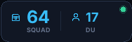
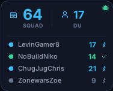
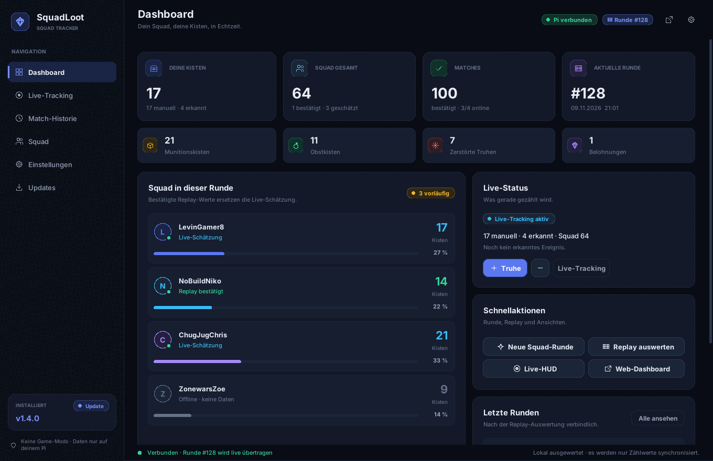
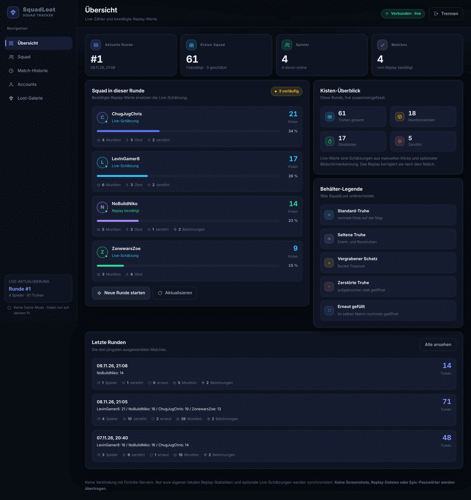
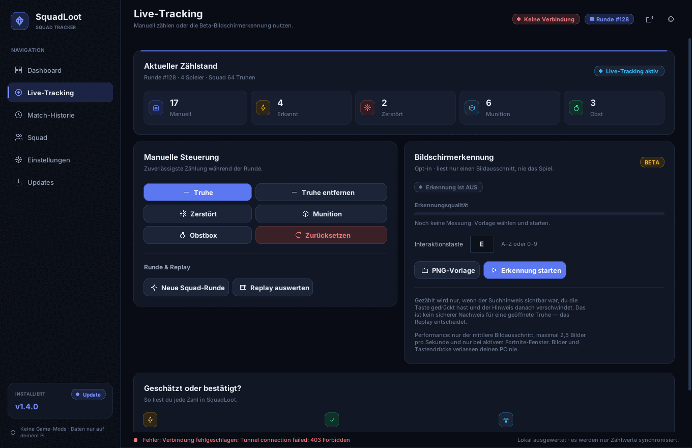
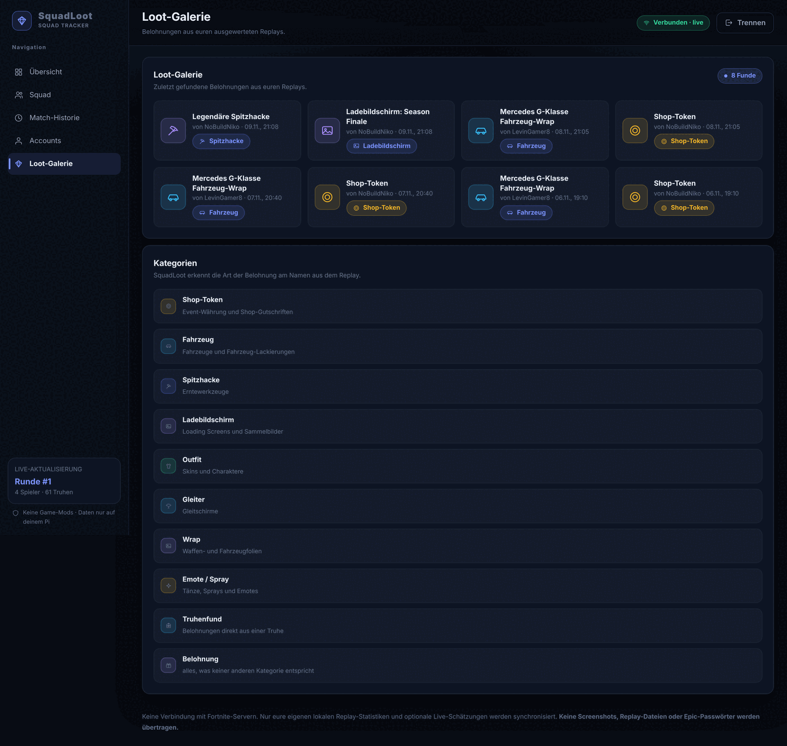
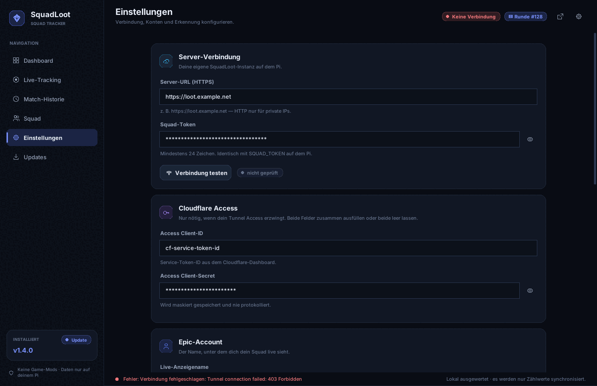
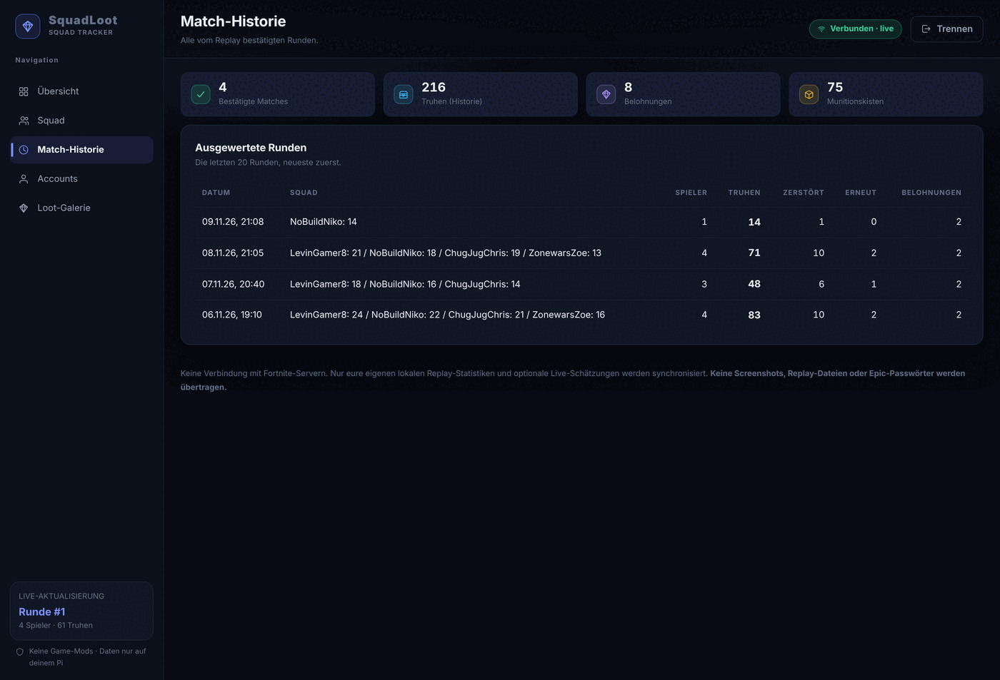

# SquadLoot – Pi-Server mit GitHub Auto-Updates

SquadLoot hostet eure Fortnite-Truhenstatistiken lokal auf dem Raspberry Pi.
Der Code ist als öffentliche Release-Quelle gedacht; **keine echten Zugangsdaten
werden in Git gespeichert**.

## SquadLoot v1.5.4 – Einfach Replay + ein Klick für Live

Das Windows-Fenster hat im Bereich **Live-Tracking** nur noch die wichtigsten
Zähler und **Live-Test starten / stoppen**. Es gibt keine separate
OBS-Ordnerauswahl, Interaktionstaste oder PNG-Suchvorlage mehr.

- **Passiv (Standard):** SquadLoot beobachtet Replays und wertet abgeschlossene
  Dateien im Hintergrund aus – bei allen Squad-Mitgliedern, auch ohne manuell
  eingetragene ChestCounter.exe. Bereits gespeicherte Matches bleiben erhalten.
- **Live (optional):** Ein Klick lädt beim ersten Mal die geprüfte, interne
  Laufzeit der visuellen Erkennung herunter und startet sie *ohne zweites GUI*.
  Die Schätzwerte werden zum Pi synchronisiert und nach Matchende durch
  Replay-Ergebnisse ergänzt beziehungsweise bestätigt.
- **Updates wie bisher:** Die Windows- und Pi-Update-ZIPs bleiben klein,
  denn die Analyse-Laufzeiten werden nur einmal in einem privaten,
  separat verwalteten Programmordner installiert. Kein manuelles Einrichten
  von Fremdprogrammen, kein zusätzliches Installationsfenster.

**Ehrliche technische Grenze:** Für diese Version verwendet SquadLoot die
ausgewerteten Open-Source-Engines weiterhin als **verwaltete Komponenten**.
Der erste Replay-Scan benötigt einmalig einen Download von ca. 38 MB und
der erste Live-Start ca. 156 MB vom jeweiligen Original-GitHub-Release.
Die Dateien werden **SHA-256-verifiziert** und bleiben unter
\`%LOCALAPPDATA%\SquadLoot\engines\`, nicht in der regulären Update-ZIP.
Keine Binärdateien werden aus unbekannten Quellen nachgeladen.

**Sprache:** Eine zuvor unter v1.5.3 erstellte eigene deutsche Truhen-XP-
Bildvorlage wird automatisch migriert. Auf einem neuen PC ohne Vorlage ist
Deutsch im visuellen Modus noch **nicht zuverlässig validiert**. Die
Replay-Analyse ist dagegen nicht von der In-Game-Sprache abhängig.
Echte deutsche XP-Popup-Bilder werden für die nächste zuverlässigere
Vorlagenausgabe benötigt.

[Kurze Testanleitung](docs/VISUAL-LIVE-TEST.md) ·
[Quellen, Lizenzen und SHA-256](docs/THIRD_PARTY_COMPONENTS.md)

## SquadLoot v1.5.3: Deutsches Truhen-XP-Popup kalibrieren

Der separat installierte Visual Chest Counter v0.2.3 unterstützt ab Werk nur
Englisch und Portugiesisch. SquadLoot kann jetzt auf Wunsch aus **einem echten
Screenshot eines deutschen Truhen-XP-Popups** eine lokale Truhenwort-Vorlage
erstellen und die Sprachauswahl des externen Programms um
**Deutsch (SquadLoot Beta)** erweitern.

Dazu unter **Live-Tracking → Deutsch kalibrieren** den Screenshot auswählen,
nur das lila XP-**Truhenwort** markieren und den externen Counter anschließend
mit Deutsch neu starten. Der externe Counter muss während der Änderung
geschlossen sein. Die Originaldateien werden gesichert und können über
**Deutsch zurücksetzen** wiederhergestellt werden.

Ohne echten deutschen Screenshot ist keine verifizierte Bildvorlage möglich.
Die Erkennung muss anhand echter deutscher Matches getestet und mit
Replay-Ergebnissen verglichen werden. Der englische Modus bleibt unverändert.
[Schritt-für-Schritt-Anleitung](docs/VISUAL-LIVE-TEST.md).

## SquadLoot v1.5.2: automatische Erkennung ohne manuelle Zählbuttons

Im Windows-Dashboard und in Live-Tracking gibt es keine Kiste+/Kiste−-,
Munition+-, Obstbox+- oder Zerstört+-Buttons mehr. Die Anzeigen stammen aus
der visuellen Erkennung beziehungsweise den später bestätigten Replays.
Neue Runde, Replay auswerten und vorläufige Werte zurücksetzen bleiben.
Ältere API-Daten und persistente SQLite-Matches bleiben erhalten. Der neue
Visual-Counter-Test und Claudes Mini-HUD funktionieren weiter unverändert.

## SquadLoot v1.5.0: Mini-HUD und visueller Live-Test

* Claudes kompaktes, klickdurchlässiges **188 x 60 px Mini-HUD** (Standardmodus),
  optional erweiterbar mit Squad-Spielern; verschiebbar, skalierbar und mit
  konfigurierbarer Transparenz. Standardmäßig AUS.
* Optionaler **Fortnite Visual Chest Counter** (externe MIT-Open-Source-App):
  In Live-Tracking den **obs_output**-Ordner auswählen und den Test starten.
  SquadLoot liest nur neue CERTAIN-/APPROX-Deltas, nicht Videodaten.
* Die externe App wird **nicht** mit SquadLoot ausgeliefert und muss zum Test
  separat aus ihrem offiziellen GitHub Release heruntergeladen werden.
* Dokumentation und Testanleitung: [Visuellen Live-Test durchführen](docs/VISUAL-LIVE-TEST.md).
* Das vollständige Matcharchiv, CSV und die originalen Fortnite-Bilder aus 1.3.1
  bleiben auf dem Pi unverändert erhalten.

### Echtes HUD von Claude





## Daten und Bilder

Der Pi verwendet dasselbe persistente Docker-Volume wie v1.3.1. **Bereits
gespeicherte Matches bleiben erhalten**; in der Web-Ansicht *Match-Historie*
gibt es weiterhin das vollständige paginierte Archiv und den geschützten
CSV-Export. Die ersten 20 Runden sind nur eine Kurzansicht.

Die Loot-Galerie zeigt bei eindeutig zuordenbaren Fortnite-Belohnungen
authentische Bilder aus einer festen Liste externer HTTPS-Quellen. Wenn das
Bild nicht erreichbar oder der Gegenstand unbekannt ist, erscheint ein
neutrales Vektor-Icon. Belohnungen werden **nicht** geraten.

## Oberfläche

Ab 1.4.0 teilen Windows-Client und Pi-Dashboard ein gemeinsames Designsystem
(dunkles Theme, Indigo-/Cyan-Akzent, Vektor-Icons statt Emojis).
Details: [docs/DESIGN.md](docs/DESIGN.md) · Änderungen: [CHANGELOG.md](CHANGELOG.md)

| Windows-Client | Pi-Dashboard |
|---|---|
|  |  |
|  |  |
|  |  |

Weitere Ansichten: [Squad](docs/screenshots/windows-squad.png) ·
[Match-Historie](docs/screenshots/windows-history.png) ·
[Updates](docs/screenshots/windows-updates.png) ·
[Mobil](docs/screenshots/web-mobile.png)

## GitHub Release veröffentlichen

Der GitHub Actions Workflow `.github/workflows/server-release.yml` erstellt bei
jedem Tag `vMAJOR.MINOR.PATCH` automatisch zwei Release-Dateien:

- `SquadLoot-RaspberryPi-Update-vX.Y.Z.zip`
- `latest.json` (mit Paket-URL, SHA-256 und Dateigröße)

Für ein neues Release die Version in `SquadLoot-Pi-Server/VERSION` anpassen,
Änderungen committen und anschließend einen neuen Tag pushen:

```bash
git add .
git commit -m "SquadLoot server v1.2.2"
git push
git tag v1.2.2
git push origin v1.2.2
```

[Installationsanleitung für GitHub und Raspberry Pi](GITHUB-ANLEITUNG.md)

**Sicherheit:** Updates werden über HTTPS aus deinem GitHub-Repository bezogen.
Der Pi prüft Paket-Hash, Dateiliste, ZIP-Inhalte und Version. Die SHA-256-Prüfung
ist jedoch keine zusätzliche kryptografische Signatur des Herausgebers.
Schütze das GitHub-Konto mit 2FA, veröffentliche nur überprüfte Tags und
verwende keine untrusted Pull-Requests als Release-Quelle.


## Windows Clients – drei Spieler

Die Freunde brauchen **keine GitHub-Zugangsdaten**. Sie laden den
[Windows-Client aus dem neuesten Release](https://github.com/LevinGamer8/SquadLoot/releases/latest)
oder einmal `SquadLoot-Freunde-Setup-vX.Y.Z.zip` und führen das enthaltene `SQUADLOOT_INSTALLIEREN.cmd` aus. Python 3.11+, ChestCounter und eingeschaltete
Fortnite-Replays sind erforderlich.

Zum Einrichten benötigt jeder Spieler:
- `https://squadloot.megacraft.de` als Serveradresse
- einen **gemeinsamen Squad-Token** (privat übermittelt)
- eine eigene **Cloudflare Access Service Client-ID und Secret** (privat)
- den eigenen Fortnite-Spielernamen

Live-Erkennung: Nur als **experimentelle Schätzung** durch optische
Erkennung + lokal abgefragte Interaktionstaste. Keine Speicherzugriffe,
keine Fortnite-Paketmanipulation oder Entschlüsselung von Live-Replays.
Bildschirmmodus standardmäßig ausgeschaltet, wenige ROI-Screenshots/Sekunde.
Für reale Daten muss jedes Match mit ChestCounter nachträglich ausgewertet werden.

### Updates

Ein Release-Tag oder ein manueller Start des Workflows erstellt
Pi-Server-ZIP, Windows-Client-ZIP, internes Windows-Update-ZIP und `latest.json`
**aus demselben Commit**. Der Pi lädt beide Pakete und stellt das Windows-
Update über die bestehende geschützte Update-API zur Verfügung. Die Apps
installieren es beim nächsten Start.
